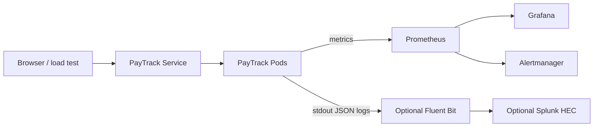

# Kubernetes Observability, Monitoring & Production Failure Recovery Lab

PayTrack is a simulated FastAPI payment API running locally on Kind. It demonstrates how metrics, logs, alerts, and runbooks work together during recovery.

Read the detailed [PayTrack application guide](docs/application-guide.md) for endpoint behaviour, sample outputs, logs, metrics, and verification workflows.



Metrics are numeric time series for trends; logs are detailed event records; alerts are rule evaluations that require action.

## Prerequisites

Docker Desktop, kubectl, Kind, Helm, and Python 3.12. Use `docker version`, `kind version`, and `helm version` to verify them.

## Quick start

```powershell
docker build -t paytrack:0.1.0 .
kind create cluster --name observability-lab --config k8s/kind/cluster.yaml
kind load docker-image paytrack:0.1.0 --name observability-lab
kubectl apply -f k8s/base/paytrack.yaml
```

Metrics Server supplies resource data to HPA (`kubectl top`); Prometheus is independent and stores application/infrastructure monitoring data.

The application is running in `monitoring-lab`; use Kubernetes port-forwarding to open local browser UIs.

```powershell
# PayTrack API: http://localhost:8000/docs and http://localhost:8000/metrics
kubectl -n monitoring-lab port-forward svc/paytrack 8000:80

# Grafana: http://localhost:3000  (user: admin, password: admin)
kubectl -n monitoring port-forward svc/monitoring-grafana 3000:80

# Prometheus: http://localhost:9090
kubectl -n monitoring port-forward svc/monitoring-kube-prometheus-prometheus 9090:9090

# Alertmanager: http://localhost:9093
kubectl -n monitoring port-forward svc/monitoring-kube-prometheus-alertmanager 9093:9093
```

Run each command in a separate PowerShell window and stop it with `Ctrl+C`.

## Alerts

Alertmanager is local-only in this lab. Open `http://localhost:9093` after the
Alertmanager port-forward. Alerts are delivered there, not to email or Slack.

```powershell
kubectl apply -f observability/paytrack-alerts.yaml
kubectl get prometheusrule -n monitoring-lab
```

Thresholds are demonstration-friendly: application/replica loss for one minute,
any restart in five minutes, CPU or memory above 80%, and 5xx errors above 5%.

## Optional Splunk logs

Splunk is intentionally not deployed without a safe test HEC endpoint and token.
See `docs/splunk.md`; use only a dedicated non-production index.

## Failure lab

Run controlled local-only scenarios from `failure-scenarios/README.md`.

Useful checks:

```powershell
kubectl get pods -n monitoring-lab
kubectl get endpointslice -n monitoring-lab -l kubernetes.io/service-name=paytrack
kubectl get pods -n monitoring
```

In Prometheus, open **Status → Targets** and confirm `paytrack` is **UP**. The Grafana password is intentionally local-lab-only and will be replaced by a Secret procedure later.
